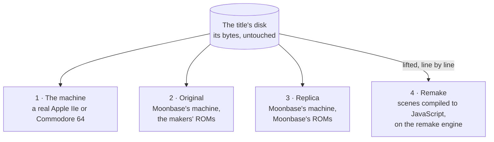
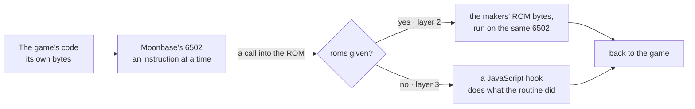
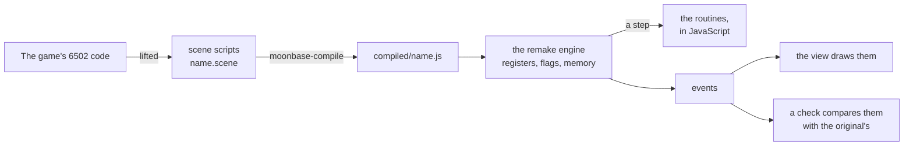
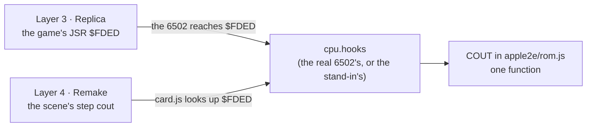

# The four layers

A title can run four ways. The first is the real machine. The other three are Moonbase's, and each one
replaces a little more of the original with JavaScript. In every layer the logic is the game's own. What
changes is what runs it.

| Layer | Name | The game's code runs on | The ROM and the disk system are |
|---|---|---|---|
| 1 | The machine | a real 6502 | the real chips |
| 2 | **Original** | Moonbase's 6502, an instruction at a time | Apple's or Commodore's own ROM bytes, run on that 6502 |
| 3 | **Replica** | the same 6502, the same way | JavaScript, answering each call at its address |
| 4 | **Remake** | no 6502: the code lifted into scenes and compiled to JavaScript | the same JavaScript answers, as steps |

The player plays layers 2, 3 and 4 (`@moonbase-machines/player`, `play()`). The way `original` is layer 2
when the page gives it the makers' ROMs (`roms`) and layer 3 when it doesn't. The way `remake` is layer 4.

## Layers 2 and 3: one machine, two kinds of ROM

The Original and the Replica are the same machine. Both use the same `Machine` class (`apple2e/machine.js`, or
`c64/machine.js` for the Commodore 64) and the same 6502 (`mos6502/cpu.js`). The game's own bytes run on it
an instruction at a time in both. The only difference is what's at the ROM's addresses.

**Layer 2, the Original.** The machine is given Apple's or Commodore's ROMs and starts at the reset vector,
as the real one did. On the Apple IIe, the Disk II card is emulated and its ROM boots the disk image, as a
school's Apple did. On the Commodore 64, Commodore's KERNAL and BASIC run, and `LOAD"…",8,1` is typed for the
game. The packages don't include the makers' ROMs, so the page supplies them where it has them.

**Layer 3, the Replica.** There are no ROM bytes. The CPU has hooks (`cpu.hooks`): when the program counter
reaches an address the machine has taken over, a JavaScript function runs in its place and the CPU returns
as if from a subroutine. Each function takes what the ROM routine took, in the registers and zero page, and
leaves what it left.

- On the Apple IIe, the Monitor's and Applesoft's routines the games call are in `apple2e/rom.js`. ProDOS's
  calls at `$BF00` are answered from the disk's files (`apple2e/mli.js`). Nothing boots: a ProDOS game's
  system file is put at `$2000` and run, and a DOS 3.3 game's files are loaded where its BASIC program put
  them, and its `CALL` is made.
- On the Commodore 64, the machine still starts at the reset vector and the same `LOAD` is typed, but the
  KERNAL and BASIC are answered in `c64/kernal.js`, `c64/basic-rom.js` and `c64/rom.js`. The ROM images hold
  only the few bytes the games read as data, and the characters are Moonbase's own
  (`@moonbase-machines/charset`).

A routine with no answer stops the machine and says where. Nothing of Apple's or Commodore's is needed.

On the Commodore 64, the 1541 is JavaScript on both layers (`c64/drive.js`). It's answered at the KERNAL's
serial bus routines rather than run as a processor of its own.

## Layer 4: the Remake

The Remake has no 6502. The game's code is lifted from the original into scene scripts, a statement to a
line with the original's address beside it, and compiled to JavaScript. The remake engine runs that
JavaScript on the same registers, flags, stack and memory the 6502 had. A call into a known routine becomes a
step, and every step is an event.

The routines come in three kinds:

- **A card title** (on the Apple IIe or the Commodore 64) uses the same JavaScript answers as the Replica
  (below). A toolkit's own code is lifted into scripts too.
- **A vector title** calls the vector engine's routines, written again in `player/remake/vector.js` by the
  original's rules. Its pictures are drawn from their shapes as SVG, at any size.
- **A title of its own engine** has no scenes. Its program's engine is written again routine for routine,
  and plays the game's data as the original read it.

`player/remake/README.md` says how the scenes are written, compiled and run.

### One answer for the Replica and the Remake

Each ROM routine a card title calls is written once, in JavaScript, and both layers 3 and 4 call that one
function. The Replica installs it on the emulated 6502's hooks. The Remake has no 6502, so
`player/remake/card.js` makes a stand-in with the same shape: the registers, the flags, `read` and `write`
into the engine's memory, and an empty `hooks` map. It hands the stand-in to the same `install()`. When a scene
reaches a step, `card.js` copies the engine's registers into the stand-in, looks up the function by the
routine's address, runs it, and copies the registers back.

Some examples:

- **COUT, `$FDED`, the Apple's character out.** `apple2e/rom.js` has `0xfded: () => cout(c.a)`. It takes the
  character from A, puts it on the text screen at the cursor, and leaves the cursor and registers as Apple's
  ROM would. On the Replica, the game's `JSR $FDED` reaches the hook. On the Remake, the scene's step `cout`
  runs the same function.
- **WAIT, `$FCA8`, the Apple's delay.** The function adds to `cycles` the time the ROM's loop took for the
  value in A. The Replica's clock moves on by that much. The Remake adds the same cycles to the engine's time
  (`card.js`, `rom`). So a pause lasts as long on both as it did on Apple's ROM.
- **CHROUT, `$FFD2`, the Commodore 64's character out.** `c64/kernal.js` sends the character to the screen,
  or to the drive or the printer when output has been redirected to a device on the bus. The Replica
  installs it through `c64/rom.js`, which calls `kernal.js`'s `install()` with the machine's processor. The
  Remake's `card.js` calls the same `install()` with its stand-in.
- **ProDOS, `$BF00`, the Apple's files.** The two layers share a class here rather than a hook: `Files` in
  `apple2e/mli.js`. The Replica's `mli()` reads the call number and the parameters' address from the three
  bytes after the game's `JSR $BF00`, then calls `files.call()`. The Remake's step `prodos` reads the same
  three bytes from its scene and makes the same call. Both read the same files from the same disk, and both
  add a disk's time for each 512-byte block read.

Because there's one copy, a fix to COUT or to the KERNAL's LOAD fixes both layers. Layer 3 is checked against
layer 2, the makers' own ROMs, so the Remake's routines are checked by that too. When the Remake and the
Original differ, the difference is in the scenes or the engine, never in a second copy of the ROM.

## What each layer is for

- **Layer 1** is the reference: what the game really did.
- **Layer 2** is the closest to layer 1 that a browser gets. It needs the makers' ROMs, so it's for a machine
  that has them.
- **Layer 3** runs the original program as it is, on nothing but Moonbase's code. Running it against layer 2
  shows that Moonbase's ROM answers do what the makers' ROMs did.
- **Layer 4** is the game made new. Because it's the original's own logic, statement for statement, its
  events can be compared with the original's, step for step, and a bug can be fixed at a known line.
